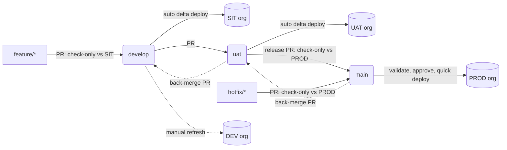

# Salesforce delta pipeline demo

DEV → SIT → UAT → PROD with automatic delta deploys, a PROD approval gate, and a hotfix lane.



| Event | Workflow | What happens |
|---|---|---|
| PR into `develop` / `uat` / `main` | `pr-validate.yml` | Check-only deploy of the PR's delta to SIT / UAT / PROD |
| Merge into `develop` | `deploy-sandbox.yml` | Delta deploy to **SIT**, running only the tests for the changed classes |
| Merge into `uat` | `deploy-sandbox.yml` | Delta deploy to **UAT** with `RunLocalTests` if Apex changed |
| Merge into `main` | `deploy-prod.yml` | Validate against PROD → **approval** → quick deploy |
| Merge into `main` | `back-merge.yml` | Opens a `main → uat` PR if `uat` is missing anything |
| Merge into `uat` | `back-merge.yml` | Opens a `uat → develop` PR if `develop` is missing anything |
| Manual | `manual-deploy.yml` | Any ref to any org (DEV included), delta or full |

The DEV org is never deployed automatically, because people build there by hand. Bring it up to date from `develop` with *Manual Deploy* when the team chooses, for example at cycle start.

## Which branch to use

| Situation | Branch | Built in | Path to PROD |
|---|---|---|---|
| New work | `feature/*` from `develop` | DEV | develop → SIT → uat → UAT → release |
| Bug in this cycle's work, found in UAT (not in PROD yet) | `fix/*` from `uat` | DEV | uat → UAT → release |
| PROD is broken and can't wait for the release | `hotfix/*` from `main` | HOTFIX sandbox (refreshed from PROD) | main → PROD straight away, with approval |

- Nobody builds in UAT. Only the pipeline writes to it, so every UAT deploy checks that git is complete.
- If a `fix/*` turns out to be urgent, cherry-pick its commit onto a `hotfix/*` branch cut from `main`.
- `develop → uat` stays a deliberate, manual PR (the promotion). Every other sync is an automatic back-merge PR.

## How the delta works

- [sfdx-git-delta](https://github.com/scolladon/sfdx-git-delta) builds `package.xml` and `destructiveChanges.xml` from a git diff.
- The diff starts at the tag `deployed/<env>` (`sit`, `uat`, `prod`), which moves only after a successful deploy. If a deploy fails, its changes are still in the next delta.
- If an org has no tag yet, all of `force-app` is deployed.
- Tests:
  - No Apex in the delta: `NoTestRun`.
  - SIT: the changed test classes, plus `<Class>Test` / `<Class>_Test` / `<Class>TestClass` for each changed class. If any class has no match, or a trigger changed, it falls back to `RunLocalTests`.
  - UAT and PROD: `RunLocalTests` whenever the delta has Apex.

## Setup (about 30 minutes)

1. **Orgs.** Sign up for 4 free Developer Edition orgs at developer.salesforce.com/signup: DEV, SIT, UAT, PROD.
2. **Auth URLs.** For SIT, UAT and PROD:
   ```
   sf org login web --alias demo-sit
   sf org display --target-org demo-sit --verbose   # copy "Sfdx Auth Url"
   ```
3. **Repo.** Create a **public** repo on your personal account. Required reviewers on environments need a public repo or a paid plan. Push this folder, then create the `develop` and `uat` branches from `main`.
4. **Environments** (Settings → Environments). Each one gets a secret named `SFDX_AUTH_URL`:

   | Environment | Org | Protection |
   |---|---|---|
   | `DEV` | DEV | none, used only by *Manual Deploy* |
   | `SIT` | SIT | none |
   | `UAT` | UAT | none (or a reviewer) |
   | `PRODUCTION-VALIDATE` | PROD | none, used only for check-only runs |
   | `PRODUCTION` | PROD | **Required reviewers**: you or a colleague |

5. **Actions settings** (Settings → Actions → General): Workflow permissions = *Read and write*, and tick *Allow GitHub Actions to create and approve pull requests* (needed for back-merge PRs).
6. **Branch protection** on `develop`, `uat` and `main`: require a PR and the `validate` status check.
7. **Seed the tags.** Run *Manual Deploy* with `scope: full` and `validation_only: false` once each for DEV, SIT, UAT and PRODUCTION. GitHub doesn't start workflows for the first push into an empty repo, so this step is needed even though the first push contains code.

`scripts/setup/connect-orgs.sh` does steps 2 and the secrets part of step 4: it logs in to the orgs and copies each auth URL to the clipboard for pasting into GitHub.

## Demo script

**Scene 1: a feature flows to SIT on its own**
1. Branch `feature/demo-1` from `develop`, change the greeting in `DemoGreetingService.cls`, open a PR.
2. Show *PR Validate*. The job summary lists one class, and the tests run are only `DemoGreetingServiceTest`.
3. Merge. *Deploy to SIT / UAT* deploys just that class. Show the `deployed/sit` tag moving.

**Scene 2: SIT catches what never made it into git**
1. In the **DEV** org, create the field `Account.Demo_Tier__c` by hand.
2. Reference it in a class, but commit **only the class**.
3. The PR validation against SIT fails with `Variable does not exist: Demo_Tier__c`. In real life this would have surfaced in UAT, or in PROD.
4. Retrieve the field, commit it, push. The check turns green.

**Scene 3: promotion to UAT and PROD**
1. PR `develop → uat`, merge. UAT receives only what changed since its last deploy.
2. PR `uat → main` (or `release/cycleXX → main`), merge.
3. *Deploy to PRODUCTION*: validation runs, then the job waits. Show the approval screen, approve, and the quick deploy finishes in seconds.

**Scene 4: hotfix lane**
1. Branch `hotfix/demo-fix` from `main`, make a one-line change, PR into `main`. It is validated straight against PROD.
2. Merge and approve. PROD gets only that one file, even though `uat` and `develop` hold unreleased work.
3. Show the `main → uat` back-merge PR that opened automatically. Merge it: UAT gets the fix, and a `uat → develop` PR opens in turn. Merge that one too and SIT gets it.

**Scene 5: metadata-only change**
Change a page layout or a field description. The pipeline deploys it with `NoTestRun` in seconds.

## Things to call out to the team

- **Org drift.** The delta assumes each org matches its tag. Hand-made changes in SIT/UAT/PROD aren't tracked. Run *Manual Deploy* with `scope: full`, `validation_only: true` on a schedule to catch drift.
- **Profiles and permission sets** are deployed as the changed files only. Keep them small, or move to permission sets only.
- **PROD coverage.** PROD always runs `RunLocalTests` when Apex changes, so coverage rules stay exactly as they are today.
- **Quick deploy window.** A validation can only be quick-deployed for a limited time and only if nothing else deploys in between, so approve promptly.
- **Hotfix rule.** A hotfix ships only the files it changed, even while `uat` and `develop` hold unreleased work. Still cut it from `main` and build it in a sandbox refreshed from PROD, so it is tested against what PROD actually runs.
- **PRs opened by the back-merge job** don't trigger *PR Validate*, because GitHub doesn't run workflows on PRs opened with `GITHUB_TOKEN`. Close and reopen the PR, or switch the job to a GitHub App or PAT token.
